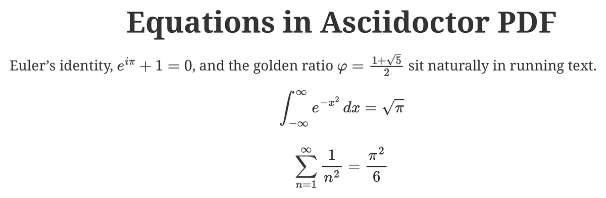
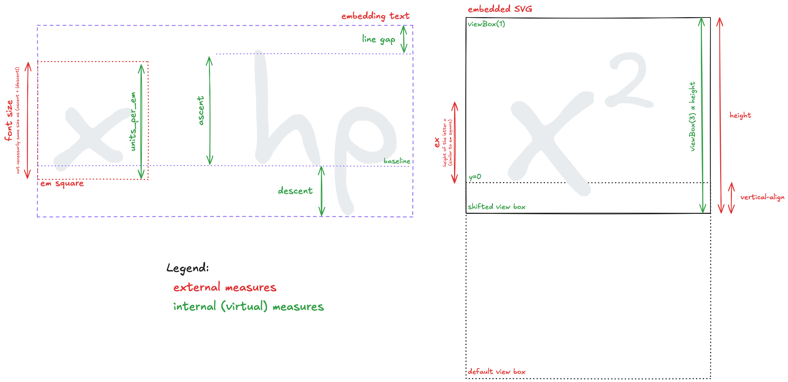

# Asciidoctor PDF MathJax


**Beautiful LaTeX and AsciiMath equations in your Asciidoctor PDFs, rendered by MathJax 4.**

`asciidoctor-pdf-mathjax` is an extension for [Asciidoctor PDF](https://github.com/asciidoctor/asciidoctor-pdf)
that turns `stem:[...]`, `latexmath:[...]`, `asciimath:[...]` and `[stem]` blocks into crisp vector
equations in your PDF output, using the same [MathJax](https://www.mathjax.org/) engine that renders your HTML docs.

```shell
gem install asciidoctor-pdf-mathjax
npm install -g @mathjax/src@4 @mathjax/mathjax-tex-font@4
asciidoctor-pdf -r asciidoctor-pdf-mathjax mathdoc.adoc
```

## Looking for an alternative to asciidoctor-mathematical?

[asciidoctor-mathematical](https://github.com/asciidoctor/asciidoctor-mathematical) is now in best-effort
legacy support, because the SVG/PNG generation it relies on is no longer maintained. Its README recommends:

> Users shall consider more capable and maintained solutions such as asciidoctor-pdf-mathjax.

This extension needs no native math libraries to compile. It only needs Ruby and Node.js, and it is actively maintained.

## Features

- **LaTeX and AsciiMath**: Both notations work, inline and in blocks.
- **Vector output**: Equations are embedded as SVG, so they stay sharp at any zoom level and in print.
- **Matches your HTML output**: The same MathJax engine renders HTML and PDF, so equations look consistent across formats.
- **Selectable math fonts**: Choose any MathJax 4 font with the `math-font` attribute (e.g. STIX2, Latin Modern, Neo-Euler).
- **Works offline**: MathJax runs from your local npm install, with no CDN or network access during the build.
- **Docker-friendly**: Builds on the official [Asciidoctor Docker image](https://github.com/asciidoctor/docker-asciidoctor); see the example [Dockerfile](test/Dockerfile).
- **Tested output**: Every change is checked against verified PDF baselines.

## Example



*Generated from [docs/example.adoc](docs/example.adoc).*

## Installation

### Prerequisites

- [Ruby](https://www.ruby-lang.org/) 2.7 or higher
- [Asciidoctor](https://asciidoctor.org/) and [Asciidoctor PDF](https://github.com/asciidoctor/asciidoctor-pdf) ([installation instructions](https://github.com/asciidoctor/asciidoctor-pdf?tab=readme-ov-file#prerequisites))
- [NodeJS](https://nodejs.org/en)
- [MathJax](https://www.mathjax.org/) 4 (required for PDF generation with LaTeX).
  Install it globally with
  ```sh
  npm install -g @mathjax/src@4 @mathjax/mathjax-tex-font@4
  ```
  The default math font is `mathjax-tex`. Install another font the same way when you select it
  with the `math-font` attribute, for example `npm install -g @mathjax/mathjax-stix2-font@4`.
  `Neo-Euler` is a font extension: `npm install -g @mathjax/mathjax-euler-font-extension@4`.

A good starting point is using the [Asciidoctor Docker Container](https://github.com/asciidoctor/docker-asciidoctor), which comes with most dependencies pre-installed.
You can find an example of a docker container configuration for Asciidoctor PDF MathJax in [this Dockerfile](test/Dockerfile).

### Installation from RubyGems

1. The `asciidoctor-pdf-mathjax` gem is available on RubyGems at https://rubygems.org/gems/asciidoctor-pdf-mathjax.
   To install it:
   ```shell
   ruby -v
   ```

   If Ruby isn’t installed, visit ruby-lang.org for installation instructions.
2. Install the `asciidoctor-pdf-mathjax` gem:
   ```shell
   gem install asciidoctor-pdf-mathjax
   ```
   This command fetches and installs the latest version of asciidoctor-pdf-mathjax along with its dependencies.
3. Verify the installation by running:
   ```shell
   gem list asciidoctor-pdf-mathjax
   ```
   You should see asciidoctor-pdf-mathjax listed with its installed version.

## Usage

To use asciidoctor-pdf-mathjax, you need to require it as an extension when running asciidoctor-pdf and ensure your
AsciiDoc document specifies the `:stem:` attribute.

### Example Asciidoctor PDF Call

Here’s how to convert an AsciiDoc file with mathematical content to PDF using this gem:

1. Create an AsciiDoc file (e.g., `mathdoc.adoc`) with STEM content:
   ```asciidoc
   = Document with Math
   :stem:

   This document includes an equation: stem:[E = mc^2].

   [stem]
   ++++
   \int_0^\infty e^{-x} \, dx = 1
   ++++
   ```

2. Run the `asciidoctor-pdf` command with the extension:
   ```shell
   asciidoctor-pdf -r asciidoctor-pdf-mathjax mathdoc.adoc -o mathdoc.pdf
   ```
   - `-r asciidoctor-pdf-mathjax`: Loads the extension.
   - `mathdoc.adoc`: The input AsciiDoc file.
   - `-o mathdoc.pdf`: The output PDF file.

3. Check the output: Open `mathdoc.pdf` to see the rendered equations (e.g., $E=mc^2$ and the integral) in high-quality
   typesetting.

#### Notes

- The `:stem:` attribute must be set in the document header or via the `-a stem` flag to enable STEM processing.
- Both inline (`stem:[...]` or `latexmath:[...]`) and block (`[stem]`) STEM content are supported.
- MathJax and its fonts are loaded from the local npm install, so rendering works offline after that install.
- The math font can be customized using the `math-font` attribute. Names from
  [MathJax Font Support](https://docs.mathjax.org/en/v4.0/output/fonts.html) are accepted, as are the
  previous MathJax 2 names (`TeX`, `STIX-Web`, `Asana-Math`, `Neo-Euler`, `Gyre-Pagella`, `Gyre-Termes`,
  `Latin-Modern`).

## Issues
Found a bug or have a suggestion? Please open an issue on the [GitHub Issues page](https://github.com/Crown0815/asciidoctor-pdf-mathjax/issues).

### Known Issues

- High inline math expressions may be cropped at the bottom due to the alignment logic.
  To avoid this, consider using block math expressions.
- For very high inline math expressions, asciidoctor-pdf will align them to the bottom of the text, which is undesired.
  To avoid this, consider using block math expressions,
  or [raise an issue in asciidoctor-pdf](https://github.com/asciidoctor/asciidoctor-pdf/issues).

## Equation alignment background



## Contributing

To set up your development environment to run the test you need to install the following:

- [Ruby](https://www.ruby-lang.org/) 3.4 or higher
- [NodeJS](https://nodejs.org/en)

The acceptance tests compare each generated PDF with its `*.verified.pdf` baseline. The comparison uses [pdf-reader](https://github.com/yob/pdf-reader) and checks page content, embedded font programs, and XObjects. Document IDs and timestamps are ignored, and no native PDF tool is required.

## License

This project is licensed under the MIT License. See the [LICENSE](LICENSE) file for details.

## Acknowledgements

- [Asciidoctor](https://asciidoctor.org/) and [Asciidoctor PDF](https://github.com/asciidoctor/asciidoctor-pdf) for the
  powerful document conversion framework.
- [MathJax](https://www.mathjax.org/) for its exceptional math rendering engine.
- The open-source community for continuous inspiration and support.
